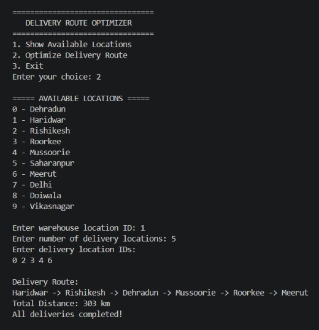

# 🚚 Delivery Route Optimizer

A C++ Data Structures and Algorithms (DSA) project that helps determine a delivery sequence using a weighted graph, Dijkstra's shortest-path algorithm, a queue, and a priority queue.

## 📌 Project Overview

The Delivery Route Optimizer is a menu-driven C++ application designed to plan delivery sequences between predefined locations.

The program represents locations as vertices and roads as weighted edges in an undirected graph. Users select a warehouse and enter their delivery locations. The system calculates the shortest distance from the current location to each pending delivery location and selects the nearest one.

This process continues until all requested deliveries are completed.

**Note:** The project uses predefined sample road distances for demonstration. These values are not verified real-world distances.

## ✨ Features

- Display all available delivery locations.
- Select a warehouse as the starting point.
- Enter multiple delivery locations using their IDs.
- Calculate shortest distances using Dijkstra's algorithm.
- Select the nearest pending delivery location at each step.
- Use a queue to manage pending deliveries.
- Use a min-priority queue to process shortest-path calculations efficiently.
- Detect invalid location IDs and duplicate delivery locations.
- Display the delivery sequence and total calculated distance.
- Provide a simple, interactive menu-driven interface.

## 📍 Available Locations

The project contains 10 predefined locations:

| ID | Location |
|---:|---|
| 0 | Dehradun |
| 1 | Haridwar |
| 2 | Rishikesh |
| 3 | Roorkee |
| 4 | Mussoorie |
| 5 | Saharanpur |
| 6 | Meerut |
| 7 | Delhi |
| 8 | Doiwala |
| 9 | Vikasnagar |

## 🛠️ Technologies Used

- **Language:** C++
- **Concepts:** Data Structures and Algorithms
- **Graph Representation:** Weighted undirected graph using adjacency lists
- **Shortest-Path Algorithm:** Dijkstra's algorithm
- **Data Structures:** Queue, priority queue, vector
- **Object-Oriented Programming:** Class, objects, constructor, member functions
- **Libraries:** iostream, vector, string, queue, climits

## ⚙️ How the Project Works

1. The program initializes 10 predefined locations.
2. Roads and their sample distances are stored as weighted graph edges.
3. The user chooses an option from the main menu.
4. To optimize a route, the user enters a warehouse ID.
5. The user enters the number of delivery locations and their IDs.
6. The program calculates the shortest-path distance from the current location to every pending delivery.
7. It selects the pending delivery with the smallest calculated distance.
8. The selected delivery is removed from the pending queue, and the process repeats.
9. The program displays the selected delivery sequence and total distance.

## 🧠 Data Structures and Algorithms

### 1. Graph

The graph represents locations and the roads connecting them.

- Vertices represent locations.
- Edges represent roads.
- Edge weights represent sample distances in kilometres.
- Roads are stored in both directions because the graph is undirected.

### 2. Dijkstra's Algorithm

Dijkstra's algorithm calculates the shortest distance between a source location and other reachable locations.

The algorithm uses a min-priority queue to process the location with the smallest currently known distance.

### 3. Queue

A queue stores the delivery locations that are still pending. After a delivery is selected, it is removed from the pending list.

### 4. Priority Queue

The priority queue is used inside Dijkstra's algorithm to process the shortest-distance candidates efficiently.

### 5. Greedy Selection

At each delivery step, the program chooses the pending location with the shortest distance from the current location.

This is a greedy strategy. It does not guarantee the globally shortest route for visiting every delivery location.

## ▶️ How to Run the Project

### Prerequisites

Install:
- A C++ compiler, such as GCC.
- Visual Studio Code or another C++ development environment.

### Step 1: Open the Project Folder

Open the folder containing the following files in Visual Studio Code:

- `main.cpp`
- `DeliverySystem.h`
- `DeliverySystem.cpp`

### Step 2: Open the Terminal

In Visual Studio Code, select:

**Terminal → New Terminal**

### Step 3: Compile the Program

Run:

```bash
g++ main.cpp DeliverySystem.cpp -o DeliveryRouteOptimizer
```

### Step 4: Execute the Program

In Windows PowerShell, run:

```powershell
.\DeliveryRouteOptimizer.exe
```

If compilation succeeds, the program will display the main menu.

## 💻 Example Run

The following is an illustrative example of the program's interaction.

```text
================================
   DELIVERY ROUTE OPTIMIZER
================================
1. Show Available Locations
2. Optimize Delivery Route
3. Exit
Enter your choice: 2

===== AVAILABLE LOCATIONS =====
0 - Dehradun
1 - Haridwar
2 - Rishikesh
3 - Roorkee
4 - Mussoorie
5 - Saharanpur
6 - Meerut
7 - Delhi
8 - Doiwala
9 - Vikasnagar

Enter warehouse location ID: 0
Enter number of delivery locations: 2
Enter delivery location IDs:
1
2

Delivery Route:
Dehradun -> Rishikesh -> Haridwar
Total Distance: 60 km
All deliveries completed!
```

**Example explanation:**

- Warehouse: Dehradun (ID 0)
- Delivery locations: Haridwar (ID 1) and Rishikesh (ID 2)
- Dehradun to Rishikesh: 35 km
- Rishikesh to Haridwar: 25 km
- Total calculated distance: 60 km

The program selects Rishikesh first because its shortest-path distance from Dehradun is smaller than Haridwar's.

## Sample Output-SS

-Here is a sample output of the program:



*The output above is illustrative; actual output depends on the selected locations and the predefined graph.*

## 📂 Project Structure

```text
Delivery-Route-Optimizer/
│
├── main.cpp
├── DeliverySystem.h
├── DeliverySystem.cpp
└── README.md
```

### File Description

| File | Purpose |
|---|---|
| `main.cpp` | Displays the menu and handles user choices. |
| `DeliverySystem.h` | Declares the DeliverySystem class, data structures, and member functions. |
| `DeliverySystem.cpp` | Implements the graph, predefined roads, shortest-path algorithm, and route selection. |
| `README.md` | Contains project documentation and execution instructions. |

## ⚠️ Limitations

- The project uses predefined locations and sample road distances.
- Users must enter location IDs instead of searching by location name.
- The program selects the nearest pending delivery at each step; it does not guarantee the globally shortest multi-stop route.
- The displayed route lists selected delivery stops, not every intermediate location along each shortest path.
- The program does not automatically return to the warehouse after completing deliveries.
- The application does not use live maps, GPS, traffic data, or a real-world road database.

## 🚀 Future Improvements

- Add more locations and road connections.
- Allow users to enter location names.
- Integrate real-world map and distance data.
- Consider traffic conditions when planning routes.
- Implement algorithms for better multi-stop route optimization.
- Add file handling to save and load location and road data.
- Improve input validation and error handling.

## 🎯 Project Objectives

- Apply graph concepts to a practical route-planning problem.
- Understand weighted graphs and shortest-path calculations.
- Implement queues and priority queues in C++.
- Apply Object-Oriented Programming concepts.
- Demonstrate how Data Structures and Algorithms can support delivery planning.

## 👨‍💻 Project Information

**Project Name:** Delivery Route Optimizer  
**Programming Language:** C++  
**Project Type:** Data Structures and Algorithms (DSA)  
**Application:** Delivery route planning using predefined locations

---

*Developed as an academic project to demonstrate the practical application of Data Structures and Algorithms in C++.*
