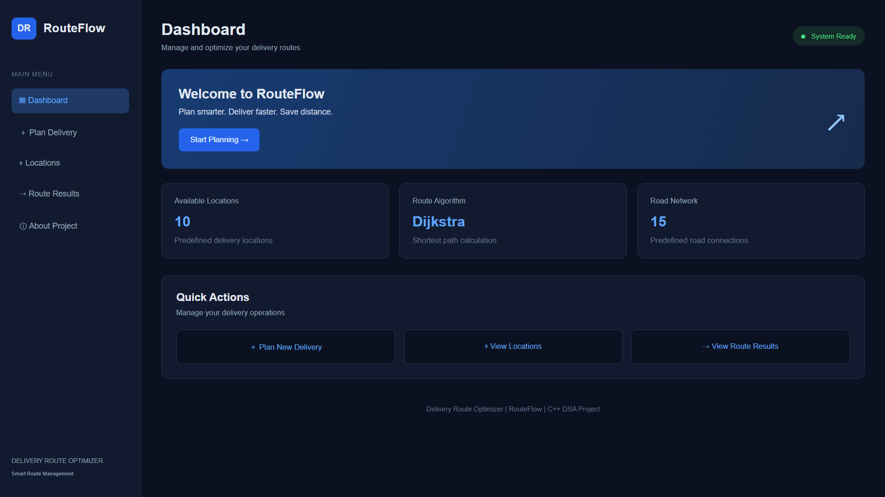
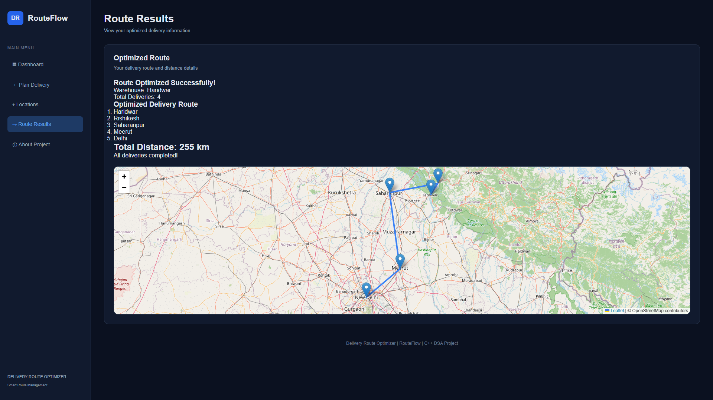

# 🚚 RouteFlow – Delivery Route Optimizer

### Smart Route Management System | C++ | DSA | Web Development

**RouteFlow** is a web-based Delivery Route Optimization System developed using C++ and modern web technologies. The project focuses on finding efficient delivery routes between multiple locations using graph-based algorithms and shortest path techniques.

It combines a C++ backend with an interactive web frontend to provide route optimization, location management, and map-based route visualization.

---

## 📌 1. Project Overview

The Delivery Route Optimizer is a software-based solution designed to improve the efficiency of delivery operations by finding the shortest possible routes between different locations.

The project represents locations as nodes and roads as weighted edges in a graph. It applies Dijkstra's Shortest Path Algorithm to determine the most efficient route based on the given distances.

Users can select their source and destination locations through a web-based interface, and the system calculates and displays the optimized route along with the total distance.

By combining Data Structures, Algorithms, and web technologies, this project provides a practical approach to solving real-world route planning problems. It aims to reduce unnecessary travel distance, save time, and improve overall delivery efficiency.
---

## 🎯 2. Project Objectives

The main objectives of RouteFlow are:

- To understand and implement graph data structures.
- To apply Dijkstra's Shortest Path Algorithm to a real-world routing problem.
- To develop a C++ backend for handling delivery and route optimization logic.
- To establish communication between the frontend and backend using HTTP.
- To create an interactive web interface for route management.
- To visualize optimized delivery routes using mapping technology.

---

## ✨ 3. Key Features

### 1. Route Optimization
Uses Dijkstra's algorithm to calculate the shortest path between selected delivery locations.

### 2. Interactive Dashboard
Provides a user-friendly web interface for accessing different sections of the application.

### 3. Location Management
Displays available delivery locations and allows users to select locations for delivery planning.

### 4. Map-Based Visualization
Uses Leaflet.js and OpenStreetMap to display route information through an interactive map.

### 5. C++ Backend
Handles location data, graph representation, shortest path calculations, and optimization requests.

### 6. Frontend-Backend Communication
Uses HTTP requests and JavaScript Fetch API to exchange information between the frontend and backend.

### 7. Route Results
Displays the calculated delivery route and relevant optimization results to the user.

---

## 🧠 4. Data Structures and Algorithms Used

The project uses fundamental Data Structures and Algorithms concepts to implement route optimization.

| Concept | Application |
|---|---|
| Graph | Represents locations and connecting roads |
| Adjacency List | Stores connections between locations |
| Weighted Edges | Represents distances between locations |
| Priority Queue | Helps process the next minimum-distance vertex |
| Dijkstra's Algorithm | Calculates shortest paths |
| Vectors | Stores location and graph-related information |
| HTTP Requests | Handles frontend-backend communication |

### Dijkstra's Shortest Path Algorithm

Dijkstra's algorithm is used to find the shortest path from a source location to other reachable locations in a weighted graph with non-negative edge weights.

**Working Process:**

1. Select the source location.
2. Initialize the distance of the source as zero and other locations as infinity.
3. Select the unvisited location with the minimum known distance.
4. Check its connected neighboring locations.
5. Update distances whenever a shorter path is found.
6. Continue until the required destination is processed.
7. Display the calculated shortest route.

This algorithm helps the system identify efficient paths between delivery locations.

---

## 🛠️ 5. Technologies Used

| Component | Technology |
|---|---|
| Programming Language | C++ |
| Backend | C++ |
| Networking | Winsock API |
| Frontend | HTML |
| Styling | CSS |
| Client-Side Logic | JavaScript |
| Map Library | Leaflet.js |
| Map Data | OpenStreetMap |
| Routing Algorithm | Dijkstra's Algorithm |
| Communication | HTTP / REST-style API |
| Code Editor | Visual Studio Code |
| Version Control | Git and GitHub |

---

## 🏗️ 6. System Architecture

RouteFlow follows a frontend-backend architecture in which both components work together to perform route optimization.

### Frontend
The frontend provides the user interface through which users can:

- View the application dashboard.
- Explore available locations.
- Select delivery locations.
- Request route optimization.
- View route results on an interactive map.

### Backend
The C++ backend is responsible for:

- Managing location information.
- Representing the road network using a graph.
- Processing optimization requests.
- Applying Dijkstra's algorithm.
- Returning calculated route information to the frontend.

### Communication

The frontend communicates with the C++ backend through HTTP requests.

JavaScript Fetch API is used to send requests and receive responses from the backend server.

---

## 📂 7. Project Structure

The project is organized into separate backend and frontend directories for better code management and maintainability.

```text
Delivery-Route-Optimization/
│
├── BACKEND/
│   ├── DeliverySystem.cpp
│   ├── DeliverySystem.h
│   ├── main.cpp
│   └── server.cpp
│
├── FRONTEND/
│   ├── index.html
│   ├── style.css
│   └── script.js
│
├── Screenshots/
│   ├── Dashboard.png
│   └── Output.png
│
├── .gitignore
└── README.md
```

### Backend Files

- **main.cpp:** Entry point of the C++ application.
- **DeliverySystem.h:** Contains the DeliverySystem class declaration and data members.
- **DeliverySystem.cpp:** Contains location management, graph construction, and route optimization logic.
- **server.cpp:** Handles HTTP server functionality and communication with the frontend.

### Frontend Files

- **index.html:** Defines the structure of the web application.
- **style.css:** Handles the visual design, layout, and styling.
- **script.js:** Manages user interactions and communication with the backend.

---

## ⚙️ 8. How the System Works

The overall working process of RouteFlow is explained below:

**Step 1: Application Launch**

The user opens the RouteFlow web application through a web browser.

**Step 2: Location Retrieval**

The frontend sends an HTTP request to the backend to retrieve available delivery locations.

**Step 3: Location Selection**

The user selects the required delivery locations through the interface.

**Step 4: Optimization Request**

The frontend sends the selected location information to the C++ backend using the Fetch API.

**Step 5: Route Calculation**

The backend processes the request and applies Dijkstra's Shortest Path Algorithm to calculate the required route.

**Step 6: Display Results**

The calculated route information is returned to the frontend and displayed to the user.

**Step 7: Map Visualization**

The route is visualized through an interactive map using Leaflet.js and OpenStreetMap.

---

## 🔗 9. API Endpoints

The frontend and backend communicate through HTTP endpoints.

| HTTP Method | Endpoint | Description |
|---|---|---|
| GET | `/api/locations` | Retrieves available delivery locations |
| POST | `/api/optimize` | Processes route optimization requests |

**Backend Server Address:**

```text
http://localhost:8080
```

These endpoints allow the frontend to retrieve location information and request route optimization from the C++ backend.

---

## 📸 10. Project Screenshots

The following screenshots demonstrate the actual working interface of the RouteFlow application.

### A. Dashboard

The dashboard provides the main interface of the application, allowing users to navigate through different sections and access delivery route management features.



### B. Optimized Route Output

This screenshot demonstrates the route optimization results, including the calculated delivery route and its map-based visualization.



---

## 🚀 11. Installation and Execution

Follow these steps to run the project on a local Windows system.

### Prerequisites

Make sure the following tools are installed:

- Windows Operating System
- Visual Studio Code
- C++ Compiler (MinGW / GCC)
- Git
- Modern Web Browser

### Step 1: Clone the Repository

Open the terminal and execute:

```bash
git clone https://github.com/Shrestha0555/Delivery-Route-Optimization.git
```

### Step 2: Open the Project

Open the cloned project folder in Visual Studio Code.

### Step 3: Compile the Backend

Compile the backend C++ source files using a compatible C++ compiler.

Make sure to link the Winsock library using:

```bash
-lws2_32
```

### Step 4: Start the Backend Server

Run the compiled server executable.

The backend server will listen on:

```text
http://localhost:8080
```

### Step 5: Launch the Frontend

Open the `FRONTEND/index.html` file in your web browser.

Alternatively, use the Live Server extension in Visual Studio Code.

**Note:** The backend server must be running before using the route optimization functionality.

---

## 🧪 12. Testing and Validation

The project can be tested using different delivery location combinations.

The following aspects are important during testing:

- Verify that all available locations are displayed correctly.
- Check whether the frontend successfully communicates with the backend.
- Verify shortest path calculations for selected locations.
- Check the displayed route results.
- Ensure that the route visualization works correctly on the map.
- Test the application with different delivery location selections.

---

## 🔮 13. Future Scope

Although RouteFlow provides basic route optimization functionality, several improvements can be introduced in future versions.

- **Multiple Vehicle Support:** Extend the system to manage multiple delivery vehicles.
- **Traffic-Based Optimization:** Consider real-time traffic conditions while calculating routes.
- **Database Integration:** Store delivery information and location records in a database.
- **Advanced Scheduling:** Introduce delivery time slots and scheduling functionality.
- **Improved Multi-Stop Optimization:** Explore advanced algorithms for optimizing routes involving multiple delivery destinations.
- **Performance Improvements:** Improve the efficiency of route calculations for larger road networks.

---

## 🎓 14. Learning Outcomes

Developing RouteFlow provided practical experience in:

- Implementing graph-based data structures in C++.
- Understanding shortest path algorithms.
- Applying Dijkstra's algorithm to a practical problem.
- Developing a web-based application using HTML, CSS, and JavaScript.
- Connecting a C++ backend with a frontend using HTTP.
- Working with Winsock for network communication.
- Using Leaflet.js and OpenStreetMap for map visualization.
- Managing project files and version control using Git and GitHub.

---

## 👨‍💻 15. Project Information

| Detail | Information |
|---|---|
| Project Name | RouteFlow – Delivery Route Optimizer |
| Project Type | Web-Based Application |
| Academic Level | 3rd Semester College Project |
| Backend Language | C++ |
| Frontend Technologies | HTML, CSS, JavaScript |
| Core Algorithm | Dijkstra's Shortest Path Algorithm |
| Development Environment | Visual Studio Code |
| Version Control | GitHub |

**GitHub Repository:**  
https://github.com/Shrestha0555/Delivery-Route-Optimization

---

## 📄 16. License

This project has been developed for educational and academic purposes.

---

### ⭐ Support

If you find this project interesting, consider giving the repository a star!

**RouteFlow – Making Delivery Route Planning Smarter.**
